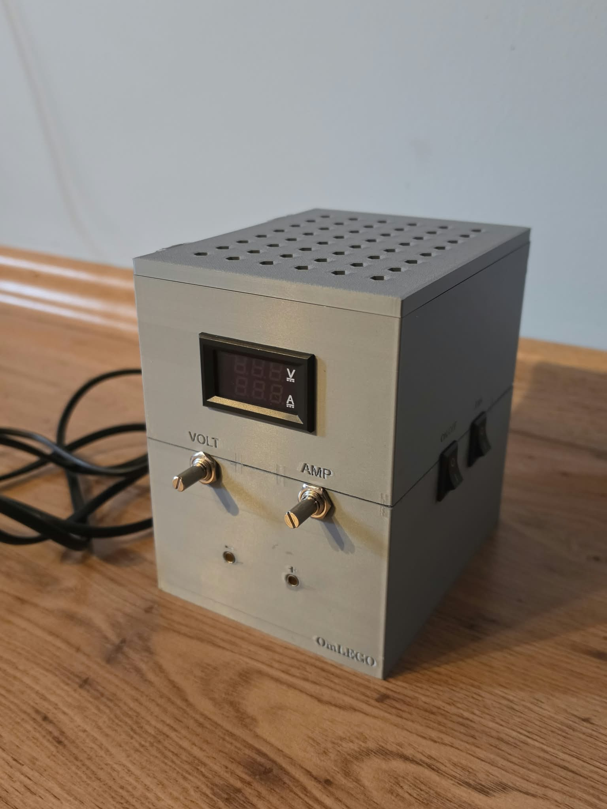
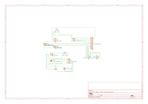
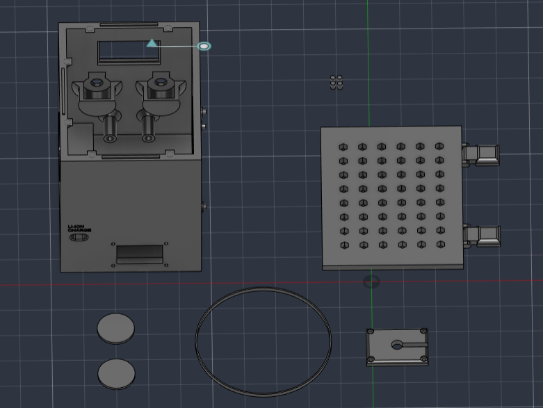
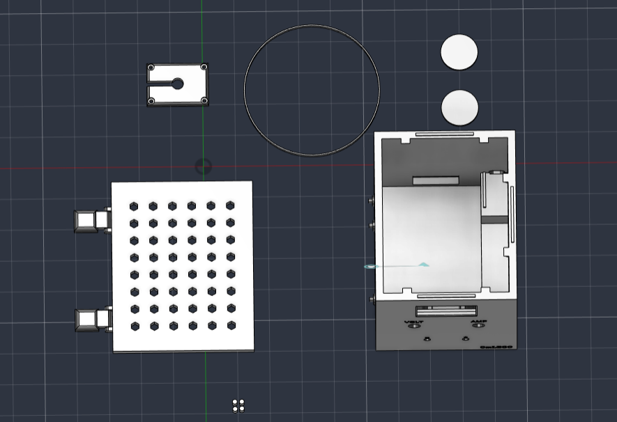
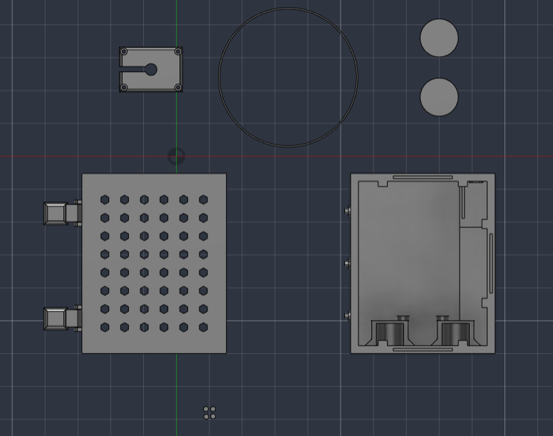
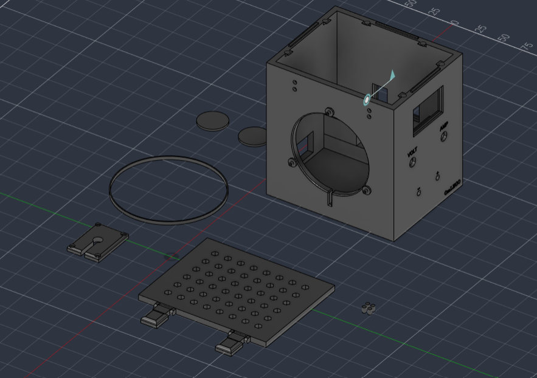
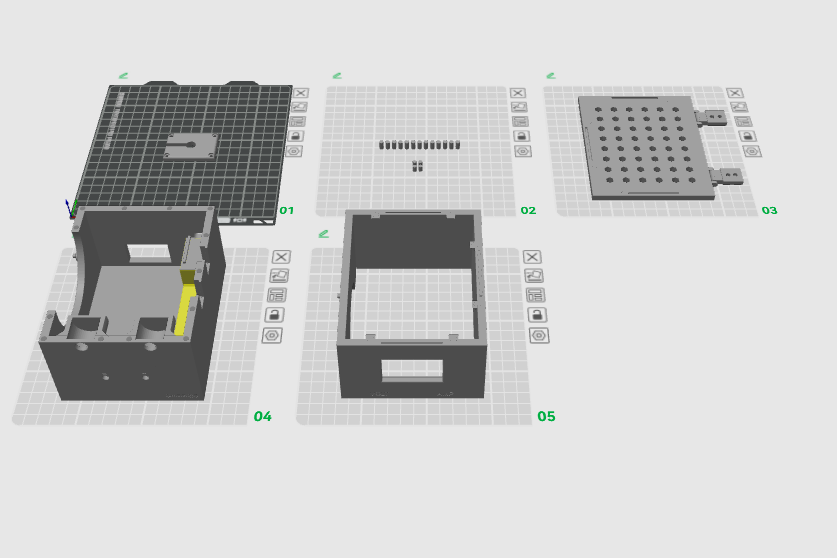
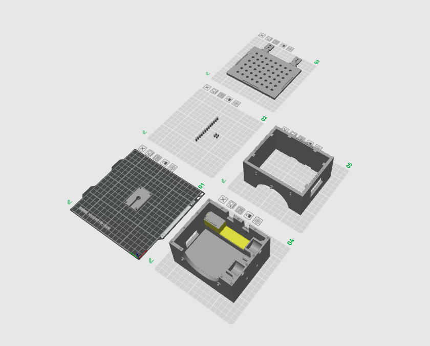
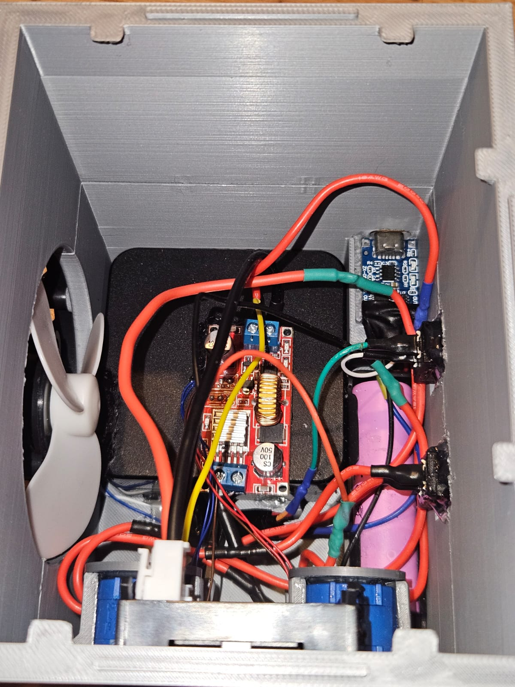

# ⚡ Star Dance - Custom 3D Printed Bench Power Supply

---

---

A reliable, non-microcontroller-based adjustable bench power supply featuring dual-channel current/voltage monitoring and an independent battery-powered cooling system, custom-designed from scratch for the Hack Club Star Dance challenge.

---

## 📋 Table of Contents
1. [Overview](#-overview)
2. [Key Features](#-key-features)
3. [Bill of Materials & Components](#-bill-of-materials--components)
4. [Circuit Architecture & Wiring](#-circuit-architecture--wiring)
5. [Circuit Schematic](#-circuit-schematic)
6. [Detailed Wiring & Pinout Guide](#-detailed-wiring--pinout-guide)
7. [Working in Action](#-working-in-action)
8. [3D Design & Enclosure Integration](#-3d-design--enclosure-integration)
9. [Step-by-Step Assembly Guide](#-step-by-step-assembly-guide)
10. [Troubleshooting & Challenges Faced](#-troubleshooting--challenges-faced)
11. [Future Improvements](#-future-improvements)
12. [AI Use](#-ai-use)
13. [License](#-license)
14. [Contributing](#-contributing)

---

## 🌟 Overview
The **Star Dance Power Supply** is a robust, desktop-class bench power supply built to provide stable, adjustable DC voltage and current for various electronics and maker projects. Unlike standard digital power supplies controlled by complex microcontrollers, this build relies on proven hardware regulation modules combined with a custom-engineered, modular 3D-printed enclosure designed in Autodesk Fusion 360.

---

## ⚙️ Key Features
* **Adjustable Output:** Smooth voltage and current regulation via a high-efficiency step-down converter.
* **Dual-Channel Monitoring:** Real-time visual feedback of both output voltage and current draw via an integrated digital display panel (DSN-VC288).
* **Independent Thermal Management:** An active cooling system powered by an independent 18650 Li-ion battery circuit to ensure continuous airflow without drawing noise or load fluctuations from the main power rail.
* **Modular Enclosure:** A split-body 3D-printed case designed for easy assembly, secure component housing, and clean cable management.

---

## 🛠️ Bill of Materials & Components
| Component | Description / Spec | Purpose |
| :--- | :--- | :--- |
| **Input Power Source** | ASUS Adapter (19V, 3.42A) | Main power input for the system |
| **Step-Down Regulator** | XL4015 DC-DC Buck Converter | Provides adjustable CV/CC power output |
| **Voltage/Current Meter** | DSN-VC288 Dual LED Panel | Displays real-time voltage and current metrics |
| **Cooling Fan** | Standard DC Fan | Dissipates heat from internal components |
| **Fan Power Circuit** | 18650 Li-ion Cell + TP4056 Module | Independent power source and safe charging for the fan |
| **Control Switches** | Rocker Switches (ON/OFF) | Power isolation and fan control |
| **Enclosure** | Custom PLA 3D Print (Split Design) | Structural housing for all internal electronics |

---

## 🔌 Circuit Architecture & Wiring
1. **Main Power Rail:** The 19V adapter input connects directly to the input terminals of the XL4015 buck converter. The output passes through the front-facing voltage/current shunt wiring to the binding posts.
2. **Display Integration:** The DSN-VC288 meter is wired into the output path to accurately measure and display voltage levels and current draw simultaneously.
3. **Cooling Subsystem:** To prevent electrical noise feedback into the main circuit, the cooling fan operates on an isolated line powered by an 18650 battery, managed via a TP4056 charging module and controlled by a dedicated rocker switch on the front panel.

---

## ⚡ Circuit Schematic

Here is teh hardware circuit schematic designed in KiCad for the project:

---

## 🔌 Detailed Wiring & Pinout Guide

To ensure safety, prevent noise interference, and maintain clean power delivery, the wiring is split into two independed circuits: the **Main Power Path** and the **Isolated Cooling Subsystem**.

### 1. Main Power Path (XL4015 & DSN-VC28)
* **Input Power:** Connect the 19V, 3.42A ASUS Adapter output to the positive (+) and negative (-) input terminals of the XL4015 step-down buck converter.
* **Output Regulation:** Wire the output terminals of the XL4015 to the input side of the DSN-VC28 dual LED meter (thick red/black wires for power input).
* **Binding Posts:** Connect the regulated output from the DSN-VC28 meter to the front-panel banana binding posts for external device connection.
* **Sampling Shunt:** Ensure the thin measurement wires of the DSN-VC28 are correctly routed across the negative output line to accurately measure current draw without voltage drop interference.

### 2. Cooling Subsystem (Isolated 18650 Power)
* **Battery Power Source:** Connect a single 18650 Li-ion cell to the TP4056 charging module input terminals for safe battery management and USB-C recharging capability.
* **Switch & Fan Control:** Route the positive output from the 18650 battery through a dedicated front-panel rocker switch directly to the DC cooling fan.
* **Electrical Isolation:** Keeping this fan circuit completely separate from the main 19V power rail ensures that fan motor noise or load fluctuations do not affect the precision of the power supply output.

---

## ⚡ Working in Action

---

## 📐 3D Design & Enclosure Integration
* **Software Used:** Autodesk Fusion 360
* **Design Strategy:** The enclosure was modeled as a modular two-part assembly to simplify printing, allow easy wiring access, and accommodate front panel cutouts for the DSN-VC288 display, potentiometers, and toggle switches.
* **Slicing & Printing:** Printed using high-quality PLA filament on a Bambu Lab printer with optimized wall generators, strong infill densities for structural rigidity, and clean support configurations.

---

---

## 🔧 Step-by-Step Assembly Guide

1. **3D Printing & Enclosure Post-Processing:** Print the upper and lower case halves using high-quality PLA on a Bambu Lab printer with optimized wall generators and Gyroid infill. Clean up any support materials from the front panel cutouts and ventilation slots.
2. **Component Dry-Fitting & Test Fit:** Securely dry-fit the DSN-VC28 voltage/current display, toggle switches, potentiometers, and binding posts into the custom front panel slots to ensure precise alignment before final wiring.
3. **Cooling Subsystem & Battery Integration:** Assemble the independent cooling fan circuit powered by an isolated 18650 battery holder, managed via a TP4056 charging module and controlled by a dedicated front-panel rocker switch to eliminate electrical noise feedback.
4. **Main Circuit Wiring & Shunt Integration:** Solder the input/output connections to the XL4015 module, carefully route the thick power lines away from sensitive measurement wires, and integrate the voltmeter shunt connections.
5. **Final Integration, Closing & Bench Testing:** Guide all internal wiring safely into the enclosure to prevent pinching, align the modular case halves, secure them, and perform a preliminary continuity and voltage output check with a multimeter.

---

## 🛠️ Troubleshooting & Challenges Faced
* **Point-to-Point Wiring Complexity:** Since I chose manual wiring over a custom printed circuit board (PCB), routing the thick power lines alongside sensitive measurement wires required careful spacing to prevent short circuits and thermal issues.
* **Thermal Management:** Keeping the cooling subsystem completely isolated from the main adjustable power path was tricky, solved by utilizing a dedicated 18650 battery and a separate switch.

---

## 🚀 Future Improvements
* **Digital Control Integration:** Upgrading the voltage regulation stage with a microcontroller-based digital potentiometer or PWM control for software-defined presets.
* **Integrated Enclosure Upgrades:** Designing a modular snap-fit front panel with integrated cable management hooks using my Bambu Lab printer.

---

.jpeg)

---

## 🤖 AI Use
AI tools were used minimally for formatting assistance and documentation structure. All design, engineering, and assembly work was done by me.

---

## 📜 License
This project is open-source and available under the [MIT License](LICENSE). 

---

## 🤝 Contributing
Contributions, bug reports, and feature suggestions are welcome! Feel free to open an issue or submit a pull request if you want to improve the enclosure design or circuit efficiency.
